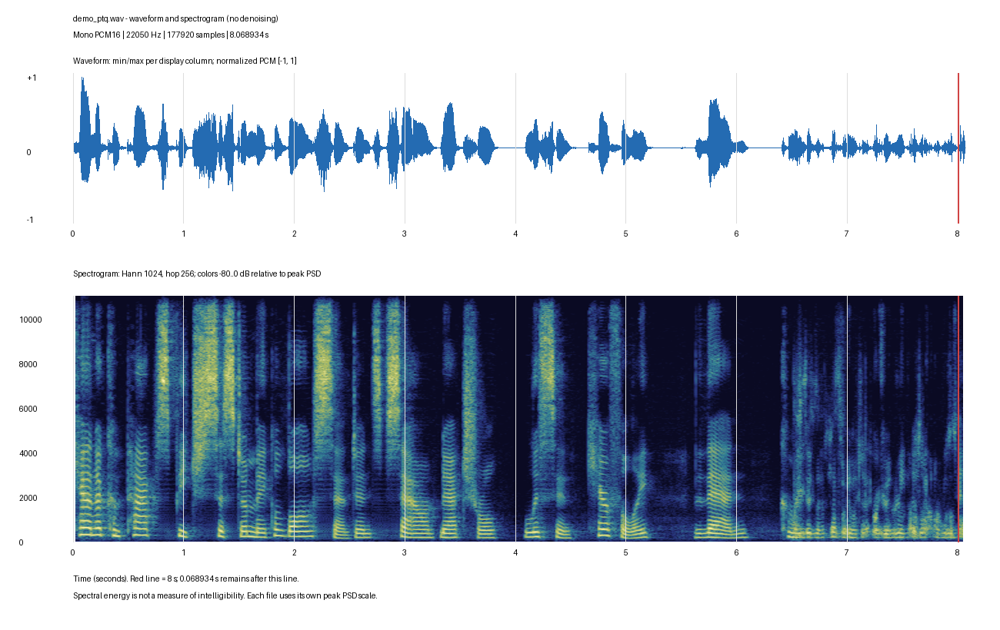
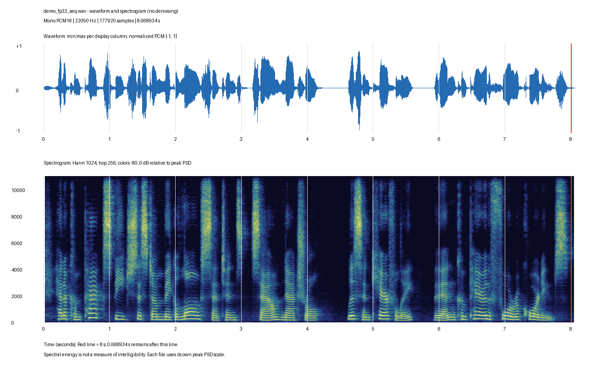

# Kiểm tra hiện tượng suy giảm âm thanh cuối câu của Piper SeqIR và ParIR sau PTQ

Ngày kiểm tra: **04/11/2026**. Phạm vi: demo OpenVINO trên N100, code hiện tại, evidence đã lưu và hai WAV người dùng cung cấp. Đây là phần tiếp nối [báo cáo kiểm kê khả năng quantization](../piper-three-configs-2026-11-04/README.vi.md).

**Chưa đủ bằng chứng để kết luận audio cứ dài hơn 8–10 giây là bị rè.** Người dùng báo hiện tượng ở cả SeqIR và ParIR. Cặp WAV đối chiếu hiện có thuộc SeqIR: cả FP32 và INT8 đều dài **8,068934 giây**. Phổ và biên độ của INT8 thay đổi đáng chú ý ở phần cuối khoảng **6,4 giây trở đi**, nên vùng cần kiểm tra không chỉ nằm sau giây thứ 8. Mốc 6,4 giây được chọn khi xem phổ của mẫu này, không phải ngưỡng lỗi đã kiểm chứng hay kết quả của thuật toán phát hiện lỗi.

Code demo không đặt giới hạn 8 hoặc 10 giây. Benchmark N100 cũ cũng chưa kiểm tra phạm vi đó: toàn bộ 2.160 lượt đo INT8 của mỗi model Piper-ParIR và Piper-SeqIR đều dưới 8 giây. Vì vậy không thể dùng kết quả timing cũ để chứng nhận chất lượng câu dài.

## 1. Hai file được đối chiếu

Người dùng xác nhận chọn **SeqIR**, nhập nguyên văn:

> Can a compact speech system make a long sentence sound natural? Listen carefully, then compare the four recordings.

Đoạn nhập có 115 ký tự, nằm trong giới hạn 200 ký tự của demo hiện tại. Người dùng cũng xác nhận **ParIR có cùng biểu hiện**, nhưng chưa có cặp WAV ParIR trong lần phân tích này.

| Thuộc tính | Bản được người dùng xác nhận là PTQ | Bản được người dùng xác nhận là FP32 |
|---|---|---|
| File trong Downloads | `demo_ptq.wav` | `demo_fp32_seq.wav` |
| Số byte | 355.884 | 355.884 |
| Định dạng | PCM16 mono | PCM16 mono |
| Sample rate | 22.050 Hz | 22.050 Hz |
| Số sample | 177.920 | 177.920 |
| Thời lượng | 8,068934 giây | 8,068934 giây |
| Phần còn lại sau giây thứ 8 | 0,068934 giây | 0,068934 giây |

Hai file khác SHA-256; không phải cùng một file được đổi tên. Các frame PCM đọc đủ theo WAV header. Đây là kiểm tra tính toàn vẹn cấu trúc, không chứng minh đã phát âm đủ câu. Việc trùng số sample cũng không chứng minh timing của từng âm vị giống nhau hoặc có một giới hạn cố định 8 giây.

- PTQ SHA-256: `2f6c47a65721a9fefeda7bc700004c5c3c43ccc29dd910198a0d966b60fd6932`
- FP32 SHA-256: `2f6ac7cc1713e12357cf3a11d23eed01ae3f999d10e459199c6b58a1a54fc31a`

Danh tính model/precision dựa trên xác nhận của người dùng. Chưa có JSON của hai request để đối chiếu hash graph, scales, phoneme IDs và `wav_sha256` với phiên demo thực tế.

## 2. Quan sát tín hiệu của SeqIR

Spectrogram dùng SciPy, Hann 1.024 sample, bước 256 sample. Màu chuẩn hóa theo peak PSD của từng file; không so độ sáng giữa hai hình như biên độ tuyệt đối. Đường đỏ là giây thứ 8.

Trong khoảng 6,4–8,0 giây, bản PTQ có biên độ nhỏ hơn, phổ tập trung nhiều vào tần số thấp và các cấu trúc hài/formant kém rõ hơn khi quan sát. Bản FP32 vẫn có các cụm âm với cấu trúc phổ thay đổi rõ đến gần cuối. Các số đo mô tả vùng nghi vấn này:

| Phép đo trên WAV đã lưu | PTQ | FP32 |
|---|---:|---:|
| RMS, đoạn 0–6,4 giây | −20,93 dBFS | −18,74 dBFS |
| RMS, đoạn 6,4–8,0 giây | −25,96 dBFS | −18,37 dBFS |
| Tỷ lệ công suất dưới 1 kHz, đoạn 6,4–8,0 | 95,97% | 86,96% |
| Tỷ lệ công suất trên 4 kHz, đoạn 6,4–8,0 | 0,84% | 8,09% |
| RMS, đoạn 8,0 giây đến hết | −25,38 dBFS | −53,28 dBFS |

Đuôi PTQ còn tín hiệu đáng kể khi FP32 đã gần im lặng. Tuy nhiên, đoạn sau giây thứ 8 chỉ dài khoảng 69 ms. Nó không đại diện cho nhiều giây bị rè sau một ngưỡng thời gian.

**Các số đo và hình phổ không phải WER, điểm chất lượng hay kết quả nghe đánh giá.** Khác timing âm vị, phụ âm xát và lấy mẫu ngẫu nhiên có thể làm các cửa sổ cùng thời gian khác nội dung. Dấu hiệu này phù hợp để khoanh vùng kiểm tra, chưa đủ xác định chính xác chữ bị mất, thời điểm bắt đầu rè hay module gây lỗi. Trong lần này không thực hiện nghe đánh giá hoặc ASR; không lấy sai số waveform từng sample làm bằng chứng lỗi PTQ.

Mỗi file chỉ có một sample gần mức toàn thang PCM16. Không thấy đoạn PCM bị bão hòa kéo dài theo kiểm tra này. Code demo chuẩn hóa peak toàn WAV, nên một sample chạm 32767 là bình thường; không thể từ đó suy ra activation trong model không bị saturation khi quantize. WAV PCM cũng không còn chứa biên độ float gốc để kiểm tra trực tiếp.

Số đo cửa sổ 0,5 giây nằm trong [PTQ CSV](evidence/demo-ptq-windows.csv), [FP32 CSV](evidence/demo-fp32-seq-windows.csv); các khoảng gộp và hash nằm trong [inspection.json](evidence/inspection.json).

## 3. Không có cơ chế đổi trạng thái ở 8 giây trong code được kiểm tra

| Vị trí | Hành vi đã xác nhận | Ý nghĩa |
|---|---|---|
| [Frontend](../../../src/hifimobinet/frontend.py) | Ghép danh sách phoneme của các câu thành một sequence; giới hạn ID gây báo lỗi | Hai câu trong đoạn nhập được đưa vào cùng một lần suy luận; không tự cắt thành các WAV 8 giây |
| [Demo engine](../../../src/hifimobinet/n100_demo.py#L225) | Một lần `InferRequest.infer`, sau đó copy toàn output | Không có cơ chế phát chunk rồi đổi precision khi đi đến giây thứ 8 |
| [WAV encoder](../../../src/hifimobinet/n100_demo.py#L154) | Kiểm tra finite/silence; chuẩn hóa một peak cho cả file | Tín hiệu hữu hạn nhưng nghe rè vẫn có thể vượt qua kiểm tra |
| Cũng tại WAV encoder | Nếu output quá 60 giây thì báo lỗi | Đây không phải cắt waveform ở 8–10 giây |
| [Giao diện LAN](../../../demo/n100_web/app.js#L30) | Nhận toàn WAV base64 rồi tạo Blob cho audio player | Không phải streaming audio từng đoạn; không có dấu hiệu code tạo noise do đường LAN chậm ở giây thứ 8 |
| [ONNX wrapper](../../../scripts/evaluation/onnx/common.py#L159) | `y_lengths` giới hạn 10.000 frame | Với hop 256 và 22.050 Hz, khoảng 116,10 giây; không giải thích mốc 8–10 giây |

Giới hạn tối đa 500 frame mỗi phoneme trong wrapper cũng không phải giới hạn tổng 8 giây. `segment_size=8192` trong training là số sample của crop huấn luyện, khoảng 0,372 giây ở 22.050 Hz, không phải 8,192 giây hay trần độ dài inference.

Các kết luận trên áp dụng cho source hiện có. JSON của request vẫn cần thiết để gắn hai WAV với đúng source/artifact đã chạy trên N100. Chuỗi xử lý WAV đầy đủ làm giả thuyết thiếu băng thông streaming ít phù hợp, nhưng chưa thay thế đối chiếu hash file server với file tải về.

## 4. Benchmark đã bao phủ độ dài nào

Đã đọc lại trực tiếp 12 file `utterances.jsonl` trong [phiên đo N100](../../../results/edge-n100-openvino/2026-11-01/evidence/results-n100-t4-20261101T080423Z), không chỉ trích lại kết luận tổng hợp:

| Model | Precision | Lượt đo | Audio dài nhất | Lượt >8 giây | Lượt >10 giây |
|---|---|---:|---:|---:|---:|
| Piper-ParIR | FP32 | 2.160 | 4,203 giây | 0 | 0 |
| Piper-ParIR | INT8 | 2.160 | 4,377 giây | 0 | 0 |
| Piper-SeqIR | FP32 | 2.160 | 7,349 giây | 0 | 0 |
| Piper-SeqIR | INT8 | 2.160 | 3,820 giây | 0 | 0 |

Mỗi dòng gồm 720 câu × 3 lượt, không phải 2.160 câu khác nhau. Đây là timing records, không phải đánh giá độ rõ chữ. File SeqIR người dùng gửi dài hơn tất cả các lượt INT8 của hai Piper IR trong bảng này.

Calibration và bộ benchmark cần phân biệt:

| Bộ dữ liệu | Số câu | Số phoneme IDs nhỏ nhất / trung vị / lớn nhất |
|---|---:|---|
| Calibration train-only | 60 | 43 / 233 / 359 |
| Harvard timing | 720 | 59 / 86 / 117 |

Không có cơ sở nói calibration chỉ dùng câu ngắn vì benchmark ngắn: số IDs trong calibration thực tế lớn hơn ở trung vị. Metadata đã đọc không có thời lượng audio sinh tương ứng của từng câu calibration; không chuyển số IDs thành thời lượng giả định. Tính đại diện về ngữ âm, ngữ cảnh và activation vẫn cần kiểm chứng. OpenVINO yêu cầu calibration đại diện cho dữ liệu sử dụng và hỗ trợ loại trừ các lớp nhạy cảm để giữ độ chính xác. [Tài liệu PTQ chính thức](https://docs.openvino.ai/2024/openvino-workflow/model-optimization-guide/quantizing-models-post-training/basic-quantization-flow.html).

## 5. Vì sao hai model có thể cùng bị ảnh hưởng dù decoder FP32

Theo [scope và runtime evidence đã kiểm kê](../piper-three-configs-2026-11-04/README.vi.md), bản selective INT8 v2 lưu trong phiên N100 có 97 weighted kernels INT8 cho mỗi Piper IR: 37 ở encoder, 20 Conv thường ở stochastic duration predictor (SDP), 40 ở main flow. Decoder và 12 depthwise Conv của SDP vẫn FP32. Đây là danh tính artifact lịch sử/cấu hình demo, chưa phải xác nhận hash artifact của hai WAV mới.

Hai model khác decoder nhưng chia sẻ cấu trúc phần trước decoder. Vì thế, giữ decoder FP32 không bảo đảm audio tốt nếu duration hoặc latent đầu vào đã bị sai. Các giả thuyết cần phân biệt:

| Vùng cần kiểm tra | Cơ chế có thể gây vấn đề | Bằng chứng còn cần |
|---|---|---|
| Encoder, đặc biệt prior projection | Sai lệch `m_p`/`logs_p` làm thay đổi latent; `exp(logs_p)` ảnh hưởng biên độ nhiễu lấy mẫu | So tensor FP32/INT8 theo vị trí phoneme/frame và clipping của activation |
| SDP và alignment | Sai duration có thể gây kéo dài, nén, lặp hoặc lệch vùng phát âm | `logw`, duration từng phoneme, alignment và tổng frame của cùng input |
| Main flow | Sai số trong các Conv biến đổi latent được truyền tới decoder FP32 | So latent trước/sau flow với cùng noise và duration |
| Calibration | Thống kê không đại diện có thể tạo scale/zero point không phù hợp với một số nội dung | Phân bố activation và saturation trên các câu lỗi, không chỉ đếm số câu |
| Frontend hoặc model FP32 | Ghép nhiều câu hoặc khả năng tổng quát hóa có thể ảnh hưởng cả hai precision | Bản FP32 cùng input, phoneme IDs và nghe theo đoạn; thử toàn đoạn và từng câu riêng trong phép thử sau |

Đây là giả thuyết kỹ thuật, **chưa phải root cause**. Hai model cùng biểu hiện khiến phần dùng chung đáng ưu tiên kiểm tra, nhưng không đủ quy lỗi chắc chắn cho encoder, SDP hay flow. Decoder ParIR/SeqIR có SnakeBeta; không thể chỉ từ tên activation suy ra đây là nguyên nhân, nhất là decoder trong artifact đang xét không chạy INT8.

Lỗi overflow ở nhánh spline rỗng trong phiên chuẩn bị INT8 ban đầu là một vấn đề đã có điều chỉnh scope ở selective INT8 v2. Không tự đồng nhất cảnh báo cũ đó với hiện tượng rè của hai WAV mới. Trạng thái `prepared` hoặc số kernel INT8 chỉ chứng minh chuẩn bị/thực thi, không chứng nhận chất lượng; preparation records vẫn ghi `INT8 listening/WER/UTMOS pending`.

## 6. Cách xác nhận ngưỡng và nguyên nhân ở phép thử tiếp theo

1. Lấy JSON của hai request SeqIR và cặp FP32/INT8 ParIR. Demo mặc định lưu tại `~/benchmarks/n100-demo-runs/<session>/`; giao diện có tải record JSON. Khớp `wav_sha256` trước, rồi xác nhận model, precision, graph hash, scales và phoneme IDs.
2. Dùng bộ câu cố định cho từng model với các nhóm độ dài đầu ra FP32: dưới 5, 5–8, 8–10, 10–15 và 15–20 giây. Ghi cả thời lượng INT8 vì quantization có thể đổi duration. Thay đổi nội dung/ngữ âm giữa các câu, lặp lại để tách ảnh hưởng RNG.
3. Nghe và ghi vị trí lỗi trên mỗi cặp, kiểm tra từng đoạn cuối câu. Báo số câu lỗi / tổng số câu mỗi nhóm. WER toàn câu có thể bổ sung nhưng không chỉ ra riêng thời điểm bắt đầu rè.
4. Nếu chỉ INT8 lỗi, kiểm tra tensor trung gian và saturation. Nếu cần so lỗi số học trực tiếp, phải kiểm soát cùng noise/duration; Python/NumPy seed không tự bảo đảm native graph RNG của OpenVINO giống nhau.
5. Chỉ sau khi có bằng chứng mới khảo sát từng phạm vi quantization riêng hoặc đưa vùng nhạy cảm về FP32. Tăng calibration hay tách câu có thể là thử nghiệm, không được coi là đã sửa tận gốc.

Chưa thực hiện phép chạy model nào trong danh sách này. Hiện có đối chiếu tín hiệu cho một câu SeqIR; chưa có dữ liệu để tính tần suất lỗi câu dài của SeqIR hoặc ParIR.

## 7. Evidence và bảo toàn nguồn

- [inspect_audio.py](inspect_audio.py): script phân tích WAV và đọc lại records, không import/chạy model.
- [inspection.json](evidence/inspection.json): metadata, SHA-256, phiên bản thư viện, số đo hai WAV, phân bố độ dài và 24 source records được hash.
- Hai CSV và hai PNG ở `evidence/`: số đo cửa sổ và hình tín hiệu.
- `SHA256SUMS`: hash các file báo cáo/derived evidence.

Đã kiểm tra lại hash nguồn sau phân tích. WAV gốc chỉ được đọc tại Downloads; không đưa audio gốc vào folder này, không sửa demo, model, evidence cũ hoặc tiến trình training. Không PTQ/export/inference/scoring/benchmark mới, không commit/push/upload. Hai PNG và số đo là dữ liệu dẫn xuất từ WAV, không phải audio được lọc hay sửa.
