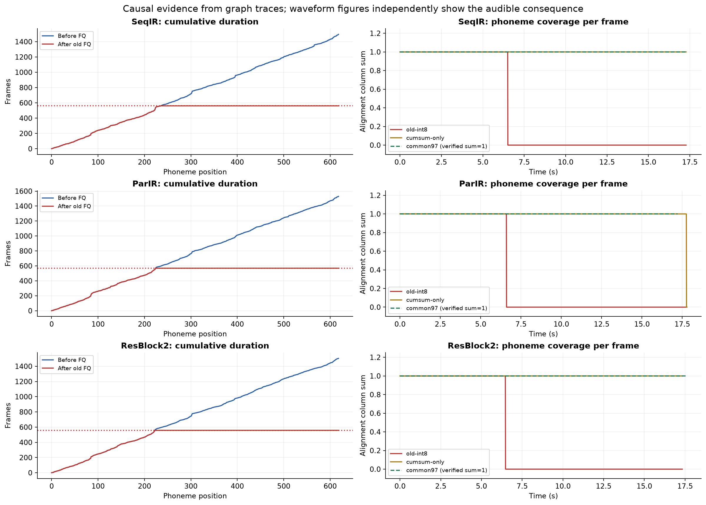
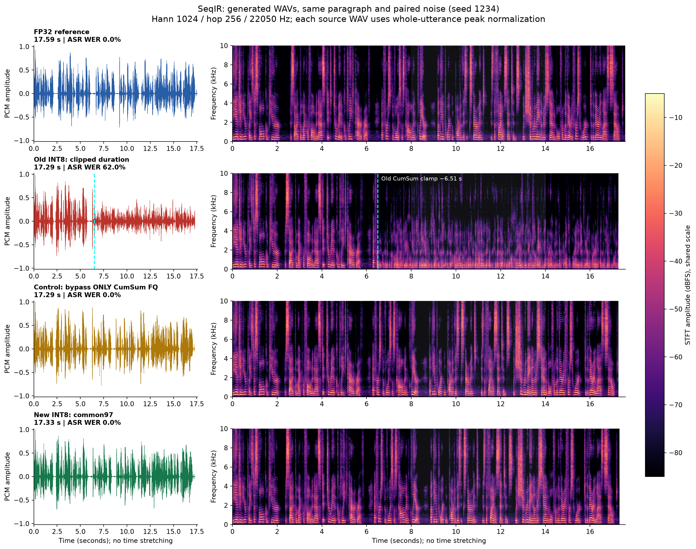
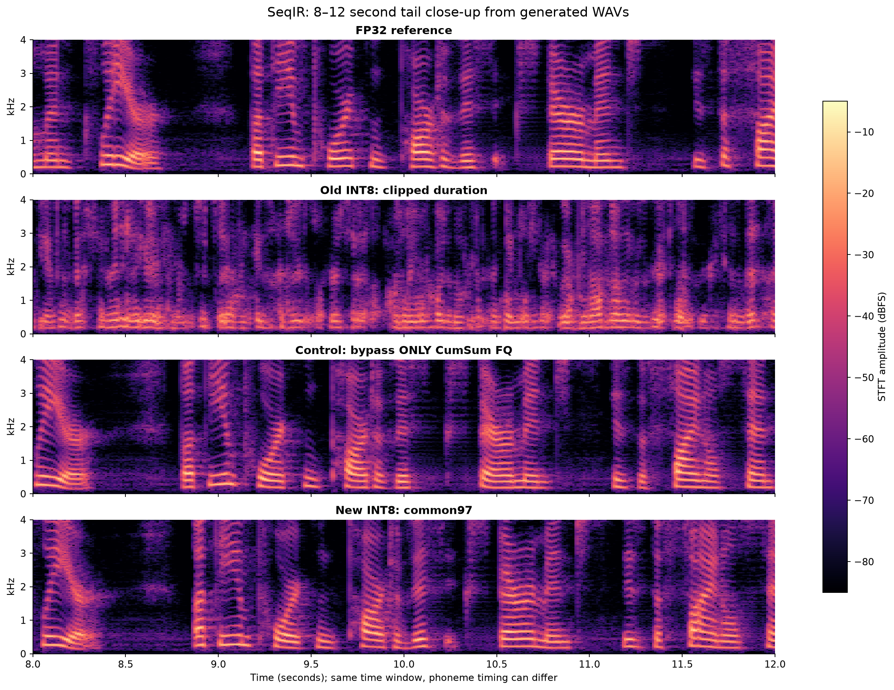
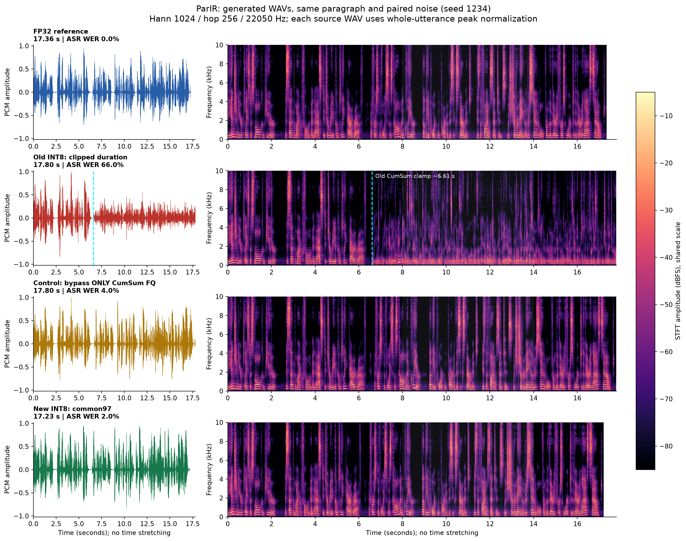
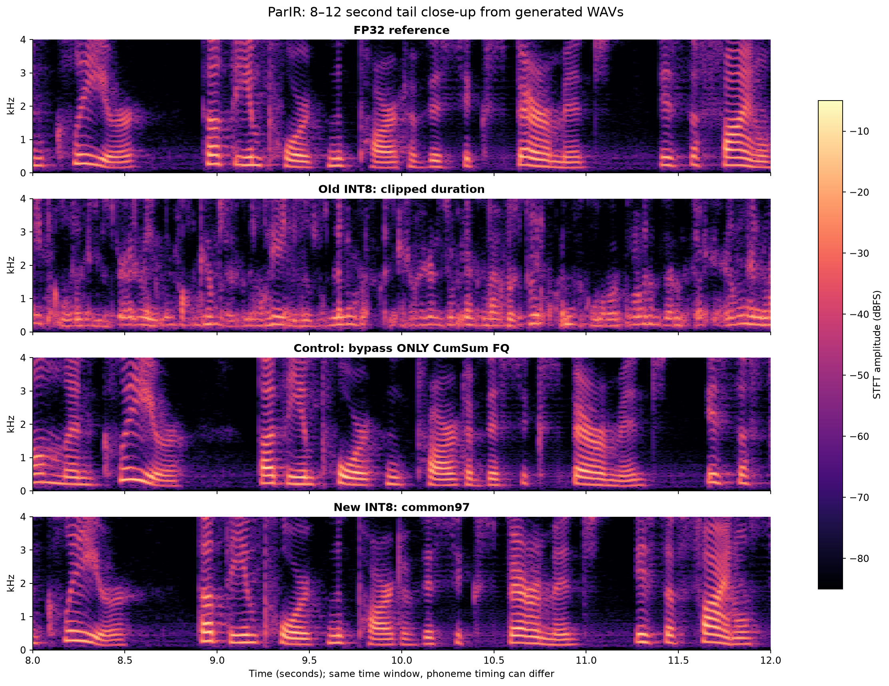
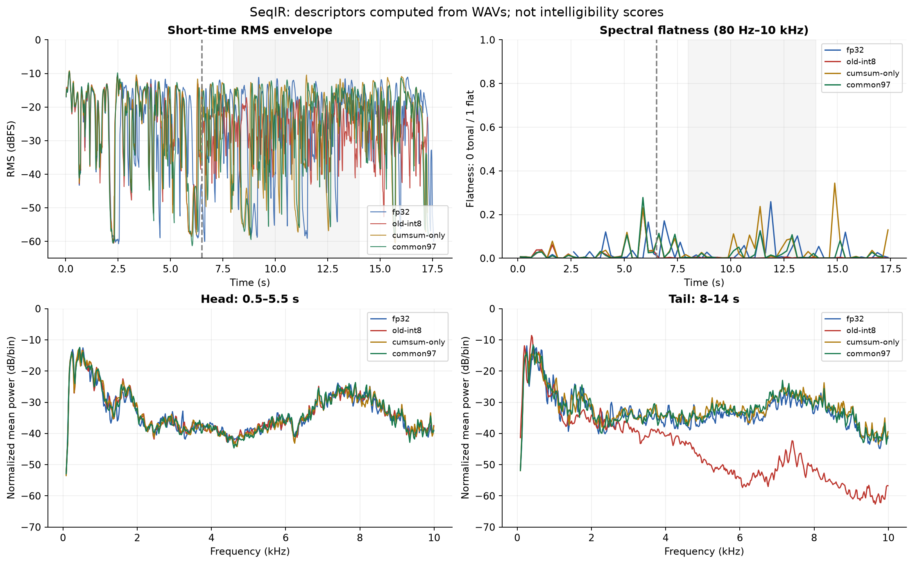
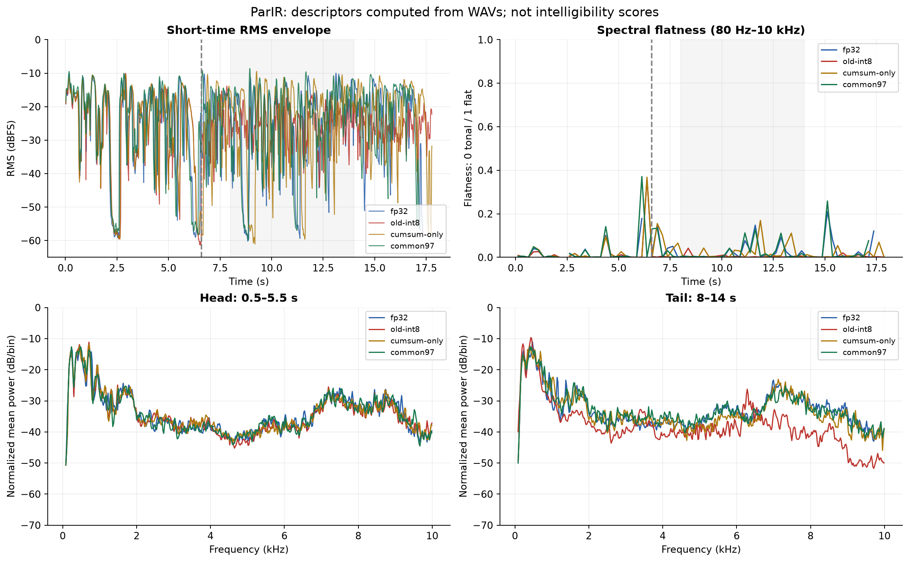
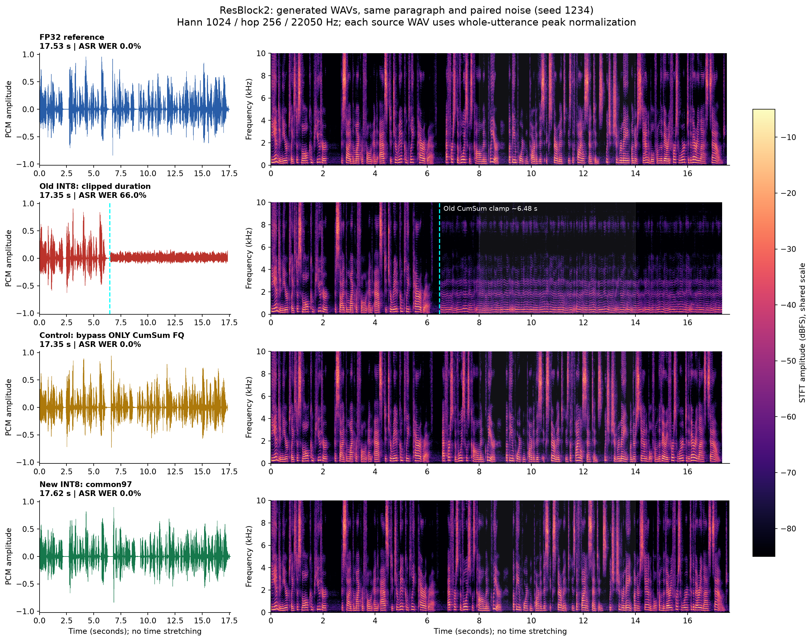
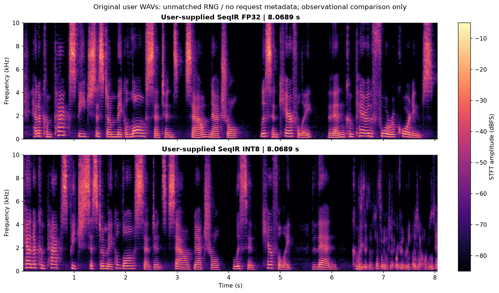
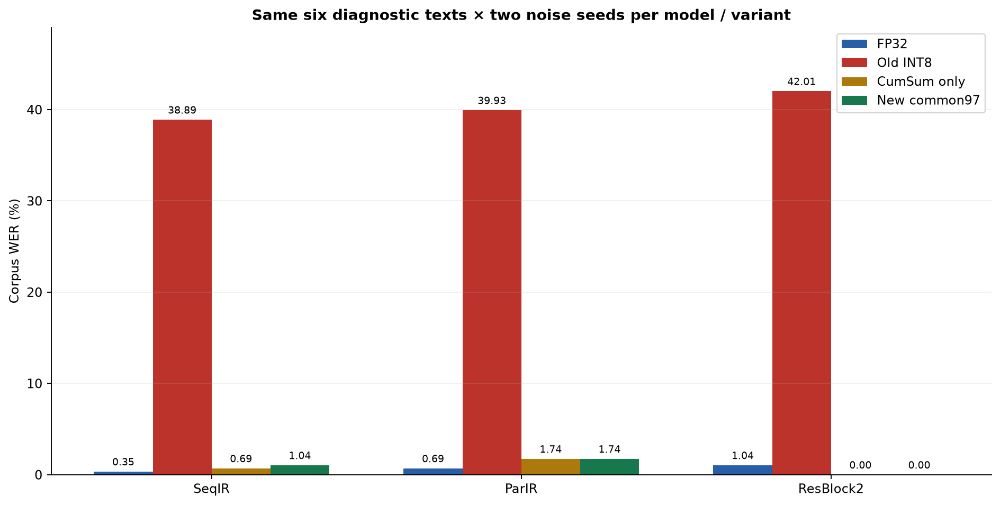

# Phân tích lỗi đuôi câu khi PTQ Piper và quá trình xây dựng common97

**Ngày lập: 04/11/2026 — Trạng thái: báo cáo thử nghiệm, chưa tích hợp thay đổi vào code demo/benchmark gốc.**

Phạm vi gồm Piper_no_VITS2_cpn (ResBlock2), Piper_ParIR_no_VITS2_cpn và Piper_SeqIR_no_VITS2_cpn. ParIR và SeqIR là hai model người dùng báo lỗi và vừa nghe thử bản sửa. Báo cáo này đối chiếu lại code, graph, trace và WAV đã sinh; các hình phổ bên dưới được tính mới trực tiếp từ WAV. Mọi nguồn gốc được giữ nguyên; thư mục này chỉ thêm báo cáo, bản sao evidence, audio và script phân tích.

Mở **[BAO-CAO.html](BAO-CAO.html)** để đọc toàn bộ báo cáo và nghe các bản trực tiếp trong trình duyệt. [NGHE-DOI-CHIEU.html](NGHE-DOI-CHIEU.html) là trang nghe riêng. Các ảnh có cả PNG và SVG để đưa vào slide hoặc bài viết.

## 1. Kết luận chính

Lỗi được xác nhận trong graph INT8 cũ là **quantizer ở đầu ra phép cộng dồn thời lượng `/CumSum/fq_output_0`**. Thời lượng cộng dồn bị kẹp ở một trần hữu hạn do calibration, khoảng 558–569 frame. Khi câu dài vượt trần, các mốc âm vị phía sau không tiếp tục tăng; alignment mất các cột gán âm vị cho phần cuối. Decoder vẫn sinh âm thanh từ latent bị mất điều kiện ngôn ngữ, nên WAV còn tiếng nhưng nội dung cuối trở thành tiếng rè/âm không rõ chữ.

Đây là lỗi lựa chọn phạm vi activation PTQ. Không có bằng chứng cho một giới hạn kiến trúc cố định “cứ trên 8 hoặc 10 giây là hỏng”. Trong graph đang xét, trần quy đổi khoảng 6,5 giây; thời điểm người nghe nhận thấy rõ lỗi có thể khác. Bản FP32 và bản common97 sinh được đoạn trên 17 giây trong cùng bài thử.

**Chứng minh nhân quả:** trên bản sao INT8 cũ, chỉ bỏ đúng một FQ ở CumSum, giữ các trọng số và mọi FQ khác, dùng cùng input nhiễu, đã khôi phục phần lớn hoặc toàn bộ nội dung cuối câu. Sau đó cấu hình common97 bảo vệ cả đường duration/alignment, xử lý luôn phần sai lệch nhỏ còn lại ở ParIR. Kết luận nguyên nhân dựa trên trace và can thiệp một node; phổ và ASR mô tả hậu quả âm thanh và mức phục hồi.

**common97 vẫn là INT8 hỗn hợp với FP32**, gồm 37 Conv encoder + 20 Conv SDP + 40 Conv main flow. Decoder giữ FP32. Giữ decoder FP32 đơn thuần không thể sửa latent đầu vào đã hỏng.

## 2. Code cũ: lỗi nằm chính xác ở đâu?

Nguồn được đọc trực tiếp: `results/edge-n100-openvino/2026-11-01/evidence/openvino_suite.py`, hàm `prepare`, dòng 229 trở đi. [Bản chụp code cũ](evidence/code/old-openvino_suite.py) được lưu kèm hash để người đọc không phụ thuộc vào thay đổi repo sau này.

| Vị trí trong file gốc | Công việc | Điều còn thiếu |
| --- | --- | --- |
| Dòng 261–266 | Tạo nhóm weighted; chọn Conv/GroupConv trong enc_p, dp, flow | `allowed` chỉ là biến Python, không phải một tham số allowlist của NNCF |
| Dòng 267–277 | Bỏ decoder, weighted op ngoài nhóm và masked-duration spline | Các operation không có trọng số như CumSum/Exp/mask ở ngoài danh sách vẫn không bị loại |
| Dòng 291–294 | Gọi `nncf.quantize(... ignored_scope=...)` | NNCF chỉ nhận danh sách bị loại, không nhận ý định “chỉ các Conv này” |
| Dòng 297 trở đi | Lưu graph, chạy smoke, kiểm runtime INT8 | WAV hữu hạn và có 97 kernel INT8 không đủ chứng minh alignment/đọc đúng phần đuôi |

Đoạn tạo phạm vi cũ, rút từ code thực tế:

```python
weighted = {"Convolution", "GroupConvolution", "ConvolutionBackpropData",
            "GroupConvolutionBackpropData", "MatMul"}
allowed = [n.get_friendly_name() for n in model.get_ops()
           if n.get_type_name() in ("Convolution", "GroupConvolution")
           and any(s in n.get_friendly_name() for s in SCOPES)]
ignored = [n.get_friendly_name() for n in model.get_ops()
           if ("/dec/" in n.get_friendly_name()
               and n.get_type_name() not in ("Constant", "Parameter", "Result"))
           or (n.get_type_name() in weighted
               and n.get_friendly_name() not in allowed)]
# Sau đó hợp thêm spline_ignored và truyền ignored_scope cho NNCF.
```

`CumSum` không phải weighted op, không nằm dưới decoder, cũng không nằm trong vùng spline bị bỏ. Vì vậy nó lọt qua chính sách này. Graph cũ thực tế có **448 FakeQuantize/model**, gồm cả `scales`, Exp, ReduceSum, CumSum và tensor mask/alignment. Số “97 INT8 kernel” chỉ đếm các kernel có trọng số; nó không phản ánh toàn bộ vị trí activation FQ.

Theo [đặc tả FakeQuantize của OpenVINO](https://docs.openvino.ai/2025/documentation/openvino-ir-format/operation-sets/operation-specs/quantization/fake-quantize-1.html), giá trị ngoài miền input bị kẹp về biên output; tensor đầu ra vẫn có thể mang kiểu float. Vì vậy nói chính xác là **đầu ra CumSum bị fake-quantize**, không nhất thiết bản thân kernel cộng dồn thực thi bằng số nguyên 8 bit.

Trong SeqIR cũ, inventory đọc từ IR cho thấy:

```text
node       : /CumSum/fq_output_0
data input : /CumSum
consumer   : /Reshape
levels     : 256
input_low  = output_low  = 0
input_high = output_high = 560.5166625976562
```

Mọi mốc lớn hơn trần đều về khoảng 560,52 frame. Ngay trong miền hợp lệ cũng có bước lượng tử khoảng 560,52/255 ≈ 2,20 frame. Đây là trần và độ phân giải của tọa độ thời gian, không phải hiện tượng biên độ WAV chạm ±1. File inventory cho [SeqIR](evidence/SeqIR-old-cumsum-quantizer.json), [ParIR](evidence/ParIR-old-cumsum-quantizer.json), [ResBlock2](evidence/ResBlock2-old-cumsum-quantizer.json) được lưu riêng.

Các graph cũ trong báo cáo là artifact N100 thuộc phiên đã có trong repo, không phải round 1 export lỗi flow weight norm. Cảnh báo overflow ở các lần chuẩn bị trước đó là một vấn đề khác: lỗi CumSum hiện tại có thể xảy ra dù toàn bộ tensor hữu hạn và numeric guard không báo lỗi.

## 3. Từ lỗi thời lượng đến tiếng rè: đường truyền trong model

Trong [models.py](evidence/code/inference-models.py), dòng 1095–1104 tạo `w`, `w_ceil`, `y_lengths` rồi gọi `commons.generate_path`. Trong [commons.py](evidence/code/generate-path-commons.py), dòng 116–129:

```python
cum_duration = torch.cumsum(duration, -1)
path = sequence_mask(cum_duration.view(b * t_x), t_y).type_as(mask)
path = path.view(b, t_x, t_y)
path = path - F.pad(path, (0, 0, 1, 0, 0, 0))[:, :-1]
```

Gọi `d_j` là số frame của âm vị thứ j, `c_j = sum(d_0 ... d_j)` là mốc kết thúc cộng dồn. Về ý nghĩa, alignment sử dụng hiệu hai mask:

```text
A[t,j] = 1(t < c_j) - 1(t < c_(j-1))

Đúng:    c_j tiếp tục tăng → mỗi frame được gán một âm vị.
Bị kẹp:  Q(c_j) = Q(c_(j-1)) = H → hiệu mask bằng 0.
Sau H:   không âm vị nào phủ các frame cuối, dù y_lengths vẫn cho sinh audio.
```

Sau đó `models.py:1106–1111` dùng alignment để đưa prior mean/log-scale từ trục âm vị sang trục thời gian. Cột alignment bằng 0 làm các giá trị tương ứng mất conditioning. Ở dòng 1122:

```python
z_p = m_p + torch.randn_like(m_p) * torch.exp(logs_p) * noise_scale
z = self.flow(z_p, y_mask, g=g, reverse=True)
o = self.dec((z * y_mask)[:, :, :max_len], ...)
```

Nếu mean và log-scale tại frame đó đều về 0 bởi phép nhân alignment, phần nhiễu vẫn còn vì `exp(0)=1`. Main flow và decoder tiếp tục xử lý latent này. Đây là lý do **còn waveform nhưng không còn lời nói đúng**, thay vì chỉ im lặng hoặc file bị cắt ngắn. Với convolution, ảnh hưởng có thể lan qua vùng lân cận theo receptive field, nên không nên coi ngưỡng quy đổi là thời điểm chuyển trạng thái nghe được chính xác đến từng sample.

### Trần và số frame lỗi đo trực tiếp

Quy đổi theo hop 256 sample/frame và sample rate 22.050 Hz. Cột cuối dưới đây dùng câu stress 289 ký tự, seed 1234; số frame lỗi lấy từ trace `/Sub`, không tính bằng cách trừ `max(CumSum) - trần`, vì đường tính tổng `y_lengths` cũ cũng có thể bị lượng tử hóa.

| Model | Trần FQ (frame) | Quy đổi giây | Frame mất alignment: cũ → chỉ bỏ CumSum → common97 |
| --- | --- | --- | --- |
| SeqIR | 560.516663 | 6.507586 | 928 → 0 → 0 |
| ParIR | 568.983337 | 6.605884 | 964 → 3 → 0 |
| ResBlock2 | 557.883362 | 6.477013 | 936 → 0 → 0 |



Ở câu người dùng ban đầu, SeqIR seed 1234 cần mốc CumSum cuối 669 frame nhưng FQ cũ chỉ cho 560,52; trace ghi **105 frame không có alignment**, bỏ riêng FQ đưa về 0. Hai WAV đối chứng vẫn cùng dài 7,732 giây. Ở câu stress, SeqIR giảm 928 → 0 frame lỗi. ParIR còn 3 frame lỗi trong mẫu stress sau can thiệp một node, trong khi common97 về 0; trên các mẫu khác phần dư có thể 1–4 frame. Không cắt đuôi để che phần dư đó.

## 4. WAV nào được dùng và cách đảm bảo đối chiếu có ý nghĩa?

Bộ hình chính dùng cùng đoạn văn, cùng phoneme IDs, scales `[0.667, 1.0, 0.8]`, seed 1234 với **hai tensor nhiễu duration/acoustic được cung cấp tường minh**. Bốn nhánh:

| Nhánh | Nguồn | Vai trò |
| --- | --- | --- |
| FP32 | `legacy-paired-v3/<model>/fp32` | Đối chứng không PTQ, dùng cùng input noise |
| INT8 cũ | `cumsum-causal-v1/<model>/paired_original_trace` | Graph cũ, có output debug trong lúc quan sát alignment |
| Chỉ bỏ FQ CumSum | `cumsum-causal-v1/<model>/paired_bypass_cumsum` | Can thiệp tối thiểu để xác định nguyên nhân |
| common97 | `common97-paired-v1/<model>/common97` | Recipe mới, làm lại PTQ từ FP32 với scope chặt |

Việc thay RNG trên bản sao graph đã được kiểm để giữ nguyên tên, input, levels và ranges của các FQ còn lại. Với SeqIR và ParIR, record FP32 có 12 ca/model đối chứng parity tensor với helper ONNX, max-absolute-error bằng 0; record ResBlock2 không có phép đối chứng tensor này nên không gán pass cho nó. Nhánh debug chỉ dùng chẩn đoán, không dùng đo tốc độ. **Cùng noise không đồng nghĩa cùng sample ở mọi thời điểm**: PTQ có thể làm duration khác, dẫn đến lệch nhịp giữa các bản. Vì vậy báo cáo không lấy waveform trừ trực tiếp rồi gọi sai số đó là “quantization noise”, không báo SNR/PESQ/LSD chưa có căn chỉnh phù hợp.

Câu dài dùng trong hình:

> The engineer placed a small computer beside the microphone and asked it to read a complete paragraph. At first the voice was calm and clear, but the important part of this experiment is the final sentence, which should remain understandable from the very first word to the very last sound.

Đây là câu stress **289 ký tự**, vượt giới hạn nhập 200 ký tự của demo hiện hành, dùng trong harness nghiên cứu. Lỗi cũng đã tái hiện với câu gốc chỉ 115 ký tự, nên kết luận không phụ thuộc vào việc vượt giới hạn UI. WAV không bị trim, nối đoạn, thêm khoảng lặng hay kéo giãn thời gian.

Phổ được tính mới từ **24 WAV đối chứng**: 3 model × 2 câu × 4 nhánh. Kèm thêm 2 WAV người dùng gửi và 2 WAV native common97 vừa được người dùng nghe thử, tổng cộng 28 WAV trong báo cáo. Hai file native mới không dùng làm phép đối chứng cùng noise; chúng giữ nguyên trong mục nghe riêng.

## 5. Hình phổ và nội dung âm thanh: SeqIR

### Toàn bộ waveform và phổ thời gian–tần số



Cách đọc: trục ngang là giây, trục dọc của phổ là kHz; màu sáng biểu thị biên độ STFT lớn hơn. Tất cả ô phổ dùng cùng thang màu −85 đến −5 dBFS. Vạch xanh ở hàng INT8 cũ chỉ trần CumSum quy đổi, không phải đường cắt WAV. Cột trái cho thấy file cũ vẫn tiếp tục phát tín hiệu đến cuối.

Sau vùng trần, bản cũ mất rõ các biến thiên phổ theo âm tiết; năng lượng còn tập trung mạnh ở dải thấp và tạo nền âm kéo dài. FP32, can thiệp CumSum và common97 vẫn có cấu trúc âm tiết, các vệt harmonic và năng lượng phụ âm biến thiên đến cuối. Không nên mô tả thành “mọi tần số biến mất”: phổ cũ vẫn khác 0 và vẫn có cấu trúc tần thấp. Điều mất chủ yếu theo bằng chứng code là **điều kiện âm vị**, hậu quả là cấu trúc phổ ngôn ngữ bị thay thế.



Hình phóng to giúp thấy rõ vùng 0–4 kHz ở 8–12 giây, giữ nguyên thang màu. Các chi tiết theo thời gian của bản mới và can thiệp một node trở lại, nhưng không cần trùng pixel với FP32 do khác duration và sai số PTQ còn lại.

| Phiên bản / WAV | Giây | WER ASR | Transcript ASR đầy đủ |
| --- | --- | --- | --- |
| [FP32](audio/SeqIR/stress_300/fp32.wav) | 17.589 | 0.00% | The engineer placed a small computer beside the microphone and asked it to read a complete paragraph. At first the voice was calm and clear, but the important part of this experiment is the final sentence, which should remain understandable from the very first word to the very last sound. |
| [INT8 cũ](audio/SeqIR/stress_300/old-int8.wav) | 17.287 | 62.00% | The engineer placed a small computer beside the microphone and asked it to read complete paragraph. Effort... The engineer placed a small computer beside the microphone and asked it to read complete |
| [Chỉ bỏ FQ CumSum](audio/SeqIR/stress_300/cumsum-only.wav) | 17.287 | 0.00% | The engineer placed a small computer beside the microphone and asked it to read a complete paragraph. At first, the voice was calm and clear, but the important part of this experiment is the final sentence, which should remain understandable from the very first word to the very last sound. |
| [INT8 mới common97](audio/SeqIR/stress_300/common97.wav) | 17.334 | 0.00% | The engineer placed a small computer beside the microphone and asked it to read a complete paragraph. At first, the voice was calm and clear, but the important part of this experiment is the final sentence, which should remain understandable from the very first word to the very last sound. |

## 6. Hình phổ và nội dung âm thanh: ParIR





ParIR có cùng cơ chế mất alignment, nhưng mức năng lượng và hình dạng noise ở đuôi không hoàn toàn giống SeqIR vì decoder khác. Vì vậy một ngưỡng “năng lượng cao tần dưới X là lỗi” không thể thay thế kiểm tra alignment và nghe/nội dung. Trên phổ, bản cũ vẫn phát âm nền ở đoạn cuối trong khi các bản khôi phục còn các chuyển tiếp tương ứng lời nói.

| Phiên bản / WAV | Giây | WER ASR | Transcript ASR đầy đủ |
| --- | --- | --- | --- |
| [FP32](audio/ParIR/stress_300/fp32.wav) | 17.357 | 0.00% | The engineer placed a small computer beside the microphone and asked it to read a complete paragraph. At first the voice was calm and clear, but the important part of this experiment is the final sentence, which should remain understandable from the very first word to the very last sound. |
| [INT8 cũ](audio/ParIR/stress_300/old-int8.wav) | 17.798 | 66.00% | The engineer placed a small computer beside the microphone and asked it to read a complete paragraph. |
| [Chỉ bỏ FQ CumSum](audio/ParIR/stress_300/cumsum-only.wav) | 17.798 | 4.00% | The engineer placed a small computer, he said the microphone, and asked it to read a complete paragraph. At first the voice was calm and clear, but the important part of this experiment is the final sentence, which should remain understandable from the very first word to the very last sound. |
| [INT8 mới common97](audio/ParIR/stress_300/common97.wav) | 17.229 | 2.00% | The engineer placed a small computer beside the microphone and asked it to read a complete paragraph. At first the voice was calm and clear that the important part of this experiment is the final sentence, which should remain understandable from the very first word to the very last sound. |

## 7. Định lượng phần đuôi: mất thông tin hay chỉ mất một dải tần?

Các chỉ số sau lấy trên cùng cửa sổ **8–14 giây** của câu stress, seed 1234. RMS tính từ toàn bộ sample trong cửa sổ. Chỉ số phổ dùng frame có RMS trên −50 dBFS để giảm tác động khoảng lặng; ngưỡng giống nhau cho mọi nhánh. Các chỉ số mô tả phổ, không phải điểm hiểu lời hay MOS.

| Model | Phiên bản | RMS (dBFS) | Năng lượng 4–10 kHz / 80 Hz–10 kHz | Centroid (Hz) | Flatness trung vị | CV envelope |
| --- | --- | --- | --- | --- | --- | --- |
| SeqIR | FP32 | -18.95 | 14.37% | 1564 | 0.00464 | 0.839 |
| SeqIR | INT8 cũ | -23.80 | 0.39% | 499 | 0.00154 | 0.583 |
| SeqIR | Chỉ bỏ FQ CumSum | -18.61 | 21.37% | 2031 | 0.00721 | 0.761 |
| SeqIR | INT8 mới common97 | -18.70 | 20.35% | 1938 | 0.00577 | 0.746 |
| ParIR | FP32 | -18.88 | 18.20% | 1803 | 0.00642 | 0.819 |
| ParIR | INT8 cũ | -23.30 | 4.39% | 730 | 0.00228 | 0.526 |
| ParIR | Chỉ bỏ FQ CumSum | -18.39 | 15.33% | 1623 | 0.00418 | 0.803 |
| ParIR | INT8 mới common97 | -17.64 | 15.08% | 1609 | 0.00582 | 0.810 |
| ResBlock2 | FP32 | -20.21 | 19.39% | 1900 | 0.00437 | 0.780 |
| ResBlock2 | INT8 cũ | -27.39 | 0.12% | 402 | 0.00095 | 0.229 |
| ResBlock2 | Chỉ bỏ FQ CumSum | -20.73 | 21.26% | 2067 | 0.00570 | 0.787 |
| ResBlock2 | INT8 mới common97 | -21.11 | 21.40% | 2080 | 0.00479 | 0.784 |

### Diễn giải theo dữ liệu, không áp đặt giả thuyết noise trắng

- **SeqIR:** tỷ trọng năng lượng 4–10 kHz giảm từ **14,37%** ở FP32 xuống **0,39%** ở INT8 cũ; common97 là **20,35%**. Spectral centroid tương ứng khoảng **1564 → 499 → 1938 Hz**. Đây là biến đổi phân bố phổ đáng kể ở phần đuôi.
- **ParIR:** cùng tỷ trọng là **18,20% → 4,39% → 15,08%**, centroid khoảng **1803 → 730 → 1609 Hz**. Hướng biến đổi giống SeqIR nhưng độ lớn khác.
- CV envelope giảm **0,839 → 0,583** ở SeqIR và **0,819 → 0,526** ở ParIR, phù hợp với nền âm ít biến thiên hơn. common97 trở về **0,746** và **0,810**. Đây không phải một ngưỡng phân loại độc lập.
- **Flatness của bản lỗi lại thấp hơn FP32**, không cao hơn: SeqIR 0,00464 → 0,00154; ParIR 0,00642 → 0,00228. Vì vậy tiếng người dùng gọi “noise/rè” ở đây **không đồng nghĩa noise trắng có phổ phẳng**. Nó có thể là âm tập trung ở tần thấp, còn tính tuần hoàn nhưng mất nội dung lời nói.
- common97 có một số chỉ số cao hơn hoặc thấp hơn FP32. Các bản có nhịp và nội dung nằm trong cửa sổ 8–14 giây hơi khác nhau; tỷ trọng cao tần lớn hơn không tự chứng minh chất lượng tốt hơn. Chỉ có thể nói phổ mới phục hồi biến thiên lời nói và kết quả đọc cuối câu trên các mẫu này.





Hai đồ thị phía dưới so sánh **phổ công suất trung bình đã chuẩn hóa tổng năng lượng trong dải 80 Hz–10 kHz** cho đầu câu 0,5–5,5 giây và đuôi 8–14 giây. Đầu câu các nhánh gần nhau hơn; phần đuôi cũ khác rõ. Do chuẩn hóa tổng, đây là tỷ trọng theo tần số, không phải công suất âm thanh vật lý tại loa. Các WAV gốc đã peak-normalize riêng từng đoạn, nên RMS của file không được dùng để kết luận hệ thống phát nhỏ đi bao nhiêu dB trước hậu xử lý; raw peak/RMS trước normalize được giữ trong measurements.json.

**Thông tin bị mất được chứng minh ở tầng alignment:** frame không còn gán âm vị. Phổ không tự “đọc” được âm vị mất nào; ASR và nghe chỉ cung cấp bằng chứng nội dung đầu ra. Kết hợp ba tầng mới cho kết luận đủ chặt: trace xác định cơ chế, hình WAV chỉ hậu quả vật lý của tín hiệu, transcript cho thấy nội dung bị sai/mất.

## 8. Đối chứng ResBlock2 và hai WAV người dùng ban đầu

Mặc dù người dùng nghe lỗi rõ trên ParIR/SeqIR, cùng policy PTQ cũng chèn FQ CumSum vào ResBlock2. Đây là lỗi phần chung trước decoder, không phải bằng chứng riêng rằng kiến trúc IR không phù hợp INT8.



[Phóng to đuôi ResBlock2](figures/ResBlock2-tail-detail.png) và [chỉ số phổ](figures/ResBlock2-spectral-metrics.png) được kèm riêng.

Hai WAV người dùng gửi ban đầu đều dài **8,0689 giây**, cùng 177.920 sample ở 22.050 Hz. Hash gốc được giữ nguyên. ASR đã ghi nhận FP32 WER 5,56% và PTQ 22,22%, với phần cuối INT8 chuyển sang nội dung khác. Cặp này không có JSON request/graph hash và không biết noise có giống nhau không; nó là bằng chứng quan sát của triệu chứng, không được dùng thay cho đối chứng một-node để kết luận nhân quả.



Nghe [FP32 người dùng](audio/user-reference/demo_fp32_seq.wav) và [PTQ người dùng](audio/user-reference/demo_ptq.wav). Transcript và hash nằm trong [user-wavs-asr.json](evidence/user-wavs-asr.json).

## 9. Từng bước đã làm để có bản mới hiện tại

### Bước 1 — Đóng băng nguồn và tái hiện

Đọc FP32 ONNX, IR INT8 cũ, code suite, manifest/calibration và WAV gốc. Hash trước/sau đảm bảo không sửa evidence. Sinh câu ngắn, câu người dùng và câu dài bằng cùng frontend, scales và sample rate. Tái hiện đuôi sai trên graph cũ. Không đổi checkpoint, không train lại, không sửa kiến trúc decoder.

### Bước 2 — Kiểm graph sau NNCF, không chỉ đọc danh sách Conv

Liệt kê mọi FakeQuantize, input/consumer, levels và bốn range. Đối chiếu 448 FQ với 97 kernel INT8; phát hiện `CumSum` nằm ngoài ý định chọn Conv. Đọc range thật thay vì suy từ thời điểm nghe rè. Thêm output debug để lấy CumSum trước/sau FQ và tổng coverage của alignment.

### Bước 3 — Tách ảnh hưởng RNG, rồi can thiệp tối thiểu

Tạo bản sao với input Gaussian duration/acoustic tường minh để hai nhánh nhận cùng noise. Kiểm FQ còn lại không đổi. Trên một bản sao khác, chỉ thay edge:

```python
fq = node_named('/CumSum/fq_output_0')
fq.output(0).replace(fq.input_value(0))
```

Đoạn trên minh họa can thiệp; code chạy thực tế nằm ở [control-cumsum_causal_probe.py](evidence/code/control-cumsum_causal_probe.py). Đây là thí nghiệm xác định nguyên nhân, **không phải sửa trực tiếp artifact gốc hay bản vá production**. Kết quả phổ/nội dung phục hồi trong khi vẫn có 97 kernel INT8 xác nhận đường duration là điểm gây lỗi.

### Bước 4 — Mở rộng ma trận để chọn scope chung

Thử đủ 16 tổ hợp bật/tắt bốn khối E (encoder), D (SDP), F (main flow), G (decoder), thêm các scope con: attention Conv, prior projection, flow pre/post, WaveNet, decoder pointwise/depthwise/upsampling, MatMul và các lớp biên. Có thử recipe cũ mới calibration lại: WER vẫn khoảng 41–43%, củng cố rằng chỉ chạy lại PTQ không giải quyết lỗi phạm vi. Tổng đợt nghiên cứu trước có **1.440 WAV đánh giá**, kết quả toàn bộ nằm trong [summary.csv](evidence/summary.csv).

Không gọi đây là tất cả mọi tổ hợp hàng trăm node hoặc mọi thuật toán/bit-width. Hai scope không tồn tại ở ResBlock2 được đánh dấu không áp dụng. Đợt này không chạy QAT hay embedding weight-only.

### Bước 5 — Chuyển từ loại trừ một số vùng sang giới hạn Conv tường minh

Code thử nghiệm mới thực tế gồm [new-run_experiment.py](evidence/code/new-run_experiment.py), hàm `scope` dòng 78–106, và [new-common97_validation.py](evidence/code/new-common97_validation.py), dòng 10–17. Tóm tắt chính sách tương đương:

```python
ops = list(model.get_ops())
allowed = {
    n.get_friendly_name() for n in ops
    if n.get_type_name() == 'Convolution'
    and n.get_friendly_name().startswith(('/enc_p/', '/dp/', '/flow/'))
}
assert len(allowed) == 97  # Guard cho đúng ba graph/version đã kiểm.
ignored = [
    n.get_friendly_name() for n in ops
    if n.get_type_name() not in ('Constant', 'Parameter', 'Result')
    and n.get_friendly_name() not in allowed
]
```

Điểm sửa cốt lõi: **mọi computational node ngoài Conv được chọn đều nằm trong ignored_scope**, thay vì chỉ loại weighted ngoài vùng/decoder/spline. Theo [hướng dẫn NNCF/OpenVINO](https://docs.openvino.ai/2025/openvino-workflow/model-optimization-guide/quantizing-models-post-training/basic-quantization-flow.html), `ignored_scope` hỗ trợ loại node theo tên, loại hoặc subgraph. Vẫn phải kiểm graph sau quantization vì propagation/fusion và tên node phụ thuộc graph/version.

`common97` còn loại **12 GroupConv/depthwise SDP** khỏi scope. Thử trước cho thấy chúng vẫn thực thi FP32 trên backend đang dùng nhưng weights/FQ có thể bị biến đổi. Loại chúng khỏi PTQ giúp giữ float đúng nghĩa cho nhánh chưa đem lại kernel INT8; không chỉ dựa vào nhãn runtime.

| Thành phần | Policy cũ | common97 |
| --- | --- | --- |
| Encoder attention/FFN/prior Conv | Cho phép | 37 Conv INT8 |
| SDP regular pre/proj/pointwise Conv | Cho phép | 20 Conv INT8 |
| SDP depthwise | Cho phép GroupConv; runtime vẫn float trong thử nghiệm | Loại khỏi PTQ |
| Main acoustic flow Conv | Cho phép | 40 Conv INT8 |
| CumSum/Exp/ReduceSum/ceil/mask/index/shape/alignment MatMul | Loại trừ chưa đầy đủ | Bảo vệ đường duration/alignment khỏi activation PTQ |
| Masked spline SDP | Đã loại | Tiếp tục float |
| Decoder / SnakeBeta / nonlinear và output | Đã giữ decoder float | Tiếp tục FP32; không dùng decoder để che lỗi upstream |
| RNG và scales | Có FQ ngoài ý định trong graph cũ | Loại khỏi phạm vi |

Danh sách chính xác từng node của từng model ở [PROPOSED-common97.json](evidence/PROPOSED-common97.json). IDs, Boolean, shape có kiểu nguyên gốc phù hợp; “giữ float” không có nghĩa ép các tensor integer/Boolean thành FP32.

### Bước 6 — Làm lại PTQ từ FP32, giữ protocol calibration

Không lấy graph INT8 cũ làm đầu vào cho một vòng quantization nữa. Bắt đầu từ FP32 ONNX đã xác minh hash; dùng cùng **60 dòng train-only**, không thêm câu chẩn đoán vào calibration; giữ MIXED preset, target CPU, fast bias correction và numeric guard. Chỉ thay chính sách scope. Các biến thể paired dùng noise tường minh; native giữ giao diện input của demo để kiểm lại riêng.

Lưu graph với `compress_to_fp16=False` để các phần được bảo vệ không bị đổi precision lưu trữ ngoài ý định. Compile CPU với f32 accuracy hint, 4 thread, 1 stream trong thử nghiệm PC. Kiểm kernel thật trong runtime model, không suy INT8 từ tên file.

### Bước 7 — Thêm kiểm tra đúng lỗi đã tìm thấy

| Điều kiện | Cũ | Mới đã kiểm |
| --- | --- | --- |
| Kernel INT8 | 97 | 97 |
| Tổng FakeQuantize | 448 | 96 |
| FQ ở đường duration/alignment được bảo vệ | Có | Không còn tại các vị trí được audit |
| Tổng coverage mỗi frame trên 36 ca | Có vùng 0 | Tất cả bằng 1 |
| Audio hữu hạn, không rỗng | Có thể vẫn đạt dù lỗi | Tiếp tục kiểm, nhưng không dùng một mình để kết luận chất lượng |
| Nội dung cuối câu | Hỏng ở nhiều câu dài | Phục hồi trên tập chẩn đoán; có WAV/ASR để đối chiếu |

96 FQ và 97 kernel không mâu thuẫn: FQ có thể được dùng chung hoặc biến đổi khi compile; không có quan hệ bắt buộc một FQ tương ứng một kernel. Guard cần kiểm **vị trí FQ + precision runtime + alignment + audio**, không chỉ một tổng đếm.

[common97-alignment-verification.json](evidence/common97-alignment-verification.json) ghi **36/36** ca (3 model × 6 câu × 2 noise seed), zero_alignment_frames=0 và min=max coverage=1. [Script kiểm alignment](evidence/code/verify_common97_alignment.py) được giữ kèm. Bộ kiểm này quan sát bản sao graph, không lưu output debug vào model triển khai.

### Bước 8 — Tách bản thử nghiệm khỏi bản triển khai

Graph paired thêm hai input noise nên không dùng thay trực tiếp model demo. Graph **native common97** vẫn có ba input `input`, `input_lengths`, `scales`; hai WAV dài người dùng vừa nghe được sinh từ bản native này. [SeqIR 16,78 giây](audio/listened-new/SeqIR-INT8-common97-long.wav), [ParIR 18,68 giây](audio/listened-new/ParIR-INT8-common97-long.wav) và [record sinh âm](audio/listened-new/record.json) giữ nguyên.

Tới thời điểm báo cáo, code mới là **harness và artifact thử nghiệm trong thư mục riêng**; code suite/demo gốc chưa được thay. Người dùng đã phản hồi hai mẫu này nghe tốt; đây là xác nhận nghe thực tế trên hai mẫu, chưa phải nghiên cứu MOS nhiều người nghe.

## 10. So sánh định lượng code cũ và mới

WER dưới đây được gộp theo tổng số từ tham chiếu: 6 câu × 2 seed, 12 WAV/model/nhánh, 288 từ tham chiếu tính cả hai lần lặp. Chỉ có 6 câu độc lập; không coi hai seed là hai câu khác. ASR là Whisper-small offline, cùng protocol. Các lần chấm có hash WAV; báo cáo này đọc lại scores đã có và kiểm khớp bytes WAV, không nhận là vừa chạy ASR lại.

| Model | FP32 | INT8 cũ | Chỉ bỏ FQ CumSum | common97 |
| --- | --- | --- | --- | --- |
| SeqIR | 0.35% | 38.89% | 0.69% | 1.04% |
| ParIR | 0.69% | 39.93% | 1.74% | 1.74% |
| ResBlock2 | 1.04% | 42.01% | 0.00% | 0.00% |



Việc chỉ bỏ một FQ đã kéo WER cũ từ khoảng 39–42% xuống 0–1,74%; đây là bằng chứng mạnh cho nguyên nhân tìm thấy. common97 có WER 0–1,74% trong paired test và alignment đầy đủ, nhưng không phải mọi từ của mọi câu đều đúng tuyệt đối. Không chọn scope dựa trên chênh lệch một vài từ của tập nhỏ. Con số common97 không nhất thiết nhỏ hơn nhánh chỉ bỏ CumSum ở mọi model, vì làm lại PTQ đổi các lượng tử hợp lệ khác và loại thêm GroupConv.

Ví dụ transcript câu gốc của SeqIR (115 ký tự), giúp kiểm phần cuối trực tiếp:

| Phiên bản / WAV | Giây | WER ASR | Transcript ASR đầy đủ |
| --- | --- | --- | --- |
| [FP32](audio/SeqIR/reported/fp32.wav) | 7.790 | 0.00% | Can a compact speech system make a long sentence sound natural? Listen carefully, then compare the four recordings. |
| [INT8 cũ](audio/SeqIR/reported/old-int8.wav) | 7.732 | 22.22% | Can a compact speech system make a long sentence sound natural? Listen carefully, then compare it with the normal speech. |
| [Chỉ bỏ FQ CumSum](audio/SeqIR/reported/cumsum-only.wav) | 7.732 | 5.56% | Can a compact speech system make a long sentence sound natural? Listen carefully and compare the four recordings. |
| [INT8 mới common97](audio/SeqIR/reported/common97.wav) | 7.779 | 5.56% | Can a compact speech system make a long sentence sound natural? Listen carefully and compare the four recordings. |

Với câu stress, bảng trong mục SeqIR/ParIR ghi transcript đầy đủ. WER riêng một câu dài có thể lớn hơn corpus WER, vì corpus còn gồm câu ngắn không vượt trần. `tail_exact` trong evidence chỉ kiểm 5 từ cuối; một từ đồng nghĩa/lỗi ASR nhỏ cũng làm nó false, nên không dùng riêng trường này để gắn nhãn “mất đuôi”.

## 11. Giới hạn và bước tiếp theo

1. **Nguyên nhân đã xác nhận trong các graph cũ đã kiểm.** Không suy rộng rằng mọi lỗi phát âm, mọi câu hoặc mọi phiên bản PTQ đều do CumSum. Các mức quantizer phụ thuộc calibration và graph; không cố định là 6,5 giây ở mọi lần chạy.
2. **Hình là tín hiệu thật từ WAV, không phải hình minh họa tạo sinh.** Vệt phổ, centroid, flatness và RMS không tự chứng minh hiểu lời; kết luận nội dung phải kết hợp nghe/ASR. Chưa làm forced alignment, PESQ, STOI, MOS hoặc ABX người nghe ở đợt báo cáo này.
3. **Chưa có RTF mới trên N100 cho common97.** Các thử nghiệm sinh/chấm trước chạy CPU PC Intel i7-14700 qua WSL, OpenVINO 2026.4.1/NNCF 3.4.0. Giữ 97 kernel INT8 không đủ kết luận tốc độ không đổi. Cần compile và kiểm runtime lại trên CPU N100.
4. **Bước tích hợp hợp lý:** đưa scope mới và các guard vào bản code riêng có phiên bản; chạy quality set độc lập gồm câu dài/ngắn, dấu câu, số và length_scale được phép; nghe A/B; đo RTF N100 cùng protocol FP32/INT8; chỉ sau đó cập nhật model demo. Báo cáo này chưa tự thực hiện tích hợp.
5. **Không khắc phục bằng cách che triệu chứng:** chia câu/cắt ở 8 giây có thể tránh vượt trần nhưng không sửa policy; tăng dữ liệu calibration chỉ dời trần nếu vẫn lượng tử hóa tọa độ cộng dồn. Giữ phép toán tạo alignment đúng precision và kiểm kết quả mới xử lý cơ chế gốc.

## 12. Phương pháp tạo hình và tái lập

- Đọc WAV mono PCM16, 22.050 Hz, chuyển sample về float bằng chia 32768; không denoise/resample/normalize thêm.
- STFT dùng periodic Hann, FFT 1024 sample (46,44 ms), hop 256 sample (11,61 ms); magnitude = `2 * abs(rfft(frame*window)) / sum(window)`. Biên độ biểu diễn bằng `20*log10(magnitude)` dBFS; cùng thang −85…−5 ở mọi hình. Trục phổ chính 0–10 kHz, zoom 0–4 kHz; Nyquist thực là 11,025 kHz.
- Flatness = trung bình nhân / trung bình cộng của power spectrum trong 80 Hz–10 kHz, có floor 1e−18. Centroid dùng trọng số power. Tỷ trọng cao tần là tổng power 4–10 kHz chia tổng 80 Hz–10 kHz. Không gọi tỷ trọng này là “tỷ lệ thông tin ngôn ngữ”.
- Metrics phổ dùng frame active RMS > −50 dBFS; RMS vùng và CV envelope dùng toàn bộ vùng. Flatness trên đồ thị thời gian gom trung vị mỗi 0,25 giây cho dễ đọc, còn số trong bảng tính từ frame gốc. Các cửa sổ head 0,5–5,5 giây và tail 8–14 giây được dùng cố định cho mọi nhánh, không chọn riêng vùng đẹp nhất.
- Các WAV đã được normalize theo peak toàn đoạn ở lúc sinh, đúng pipeline demo; raw peak/RMS trước bước này giữ trong [measurements.json](evidence/measurements.json). Chênh lệch thời lượng không bị sửa để các hình khớp nhau.
- Script [build_evidence.py](build_evidence.py) chỉ đọc WAV, trace và code; không inference/train/PTQ. [write_report.py](write_report.py) tạo Markdown/HTML từ số đã đo. [analysis-method.json](evidence/analysis-method.json) ghi phiên bản thư viện và tham số.

Chạy lại trên WSL từ repo, bằng môi trường đã có:

```bash
.local/ptq-ablation-20261104/venv/bin/python -B docs/quantization/piper-ptq-tail-fix-2026-11-04/build_evidence.py
.local/ptq-ablation-20261104/venv/bin/python -B docs/quantization/piper-ptq-tail-fix-2026-11-04/write_report.py
.local/ptq-ablation-20261104/venv/bin/python -B docs/quantization/piper-ptq-tail-fix-2026-11-04/verify_report.py
```

Lệnh tạo lại báo cáo/ảnh trong chính thư mục báo cáo; cần giữ nguồn `.local/ptq-ablation-20261104` và `.local/ptq-listening-20261104`. Để chỉ đọc/nghe, thư mục báo cáo hiện tại đã chứa các WAV, hình và số liệu cần thiết, không cần môi trường Python.

Tệp kiểm: [source-hashes.json](evidence/source-hashes.json) xác minh nguồn không đổi; [acoustic-metrics.csv](evidence/acoustic-metrics.csv) lưu số âm học; [quality-summary.json](evidence/quality-summary.json) lưu WER; [SHA256SUMS](SHA256SUMS) kiểm payload báo cáo; [VERIFICATION.json](VERIFICATION.json) ghi kết quả kiểm file và liên kết. Các graph nhiều GB không sao chép lại vào báo cáo; đường dẫn, inventory và hash của thí nghiệm gốc được giữ để truy vết.

Tài liệu cơ chế dùng để đối chiếu là đặc tả FakeQuantize và ignored_scope chính thức đã dẫn ở mục 2 và 9. Các con số, biểu đồ và kết luận về ba model trong báo cáo xuất phát từ code/graph/WAV của project, không lấy từ benchmark bên ngoài.
